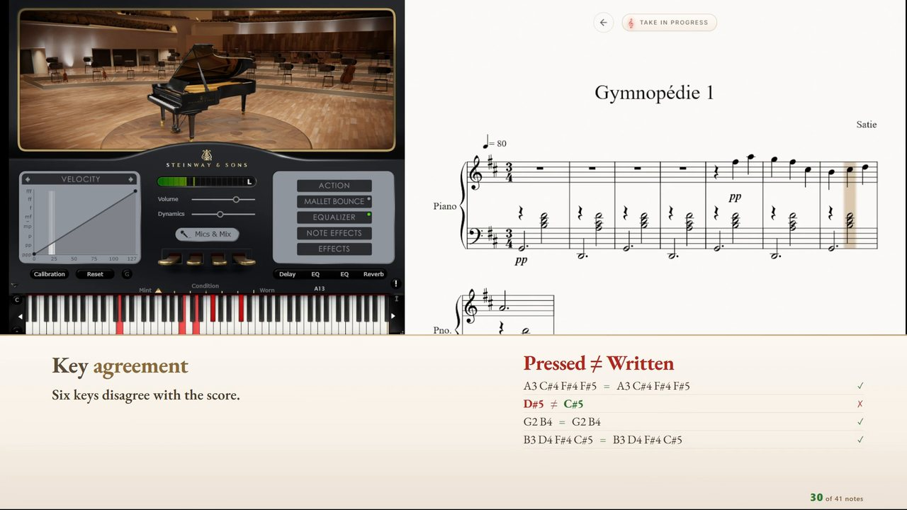
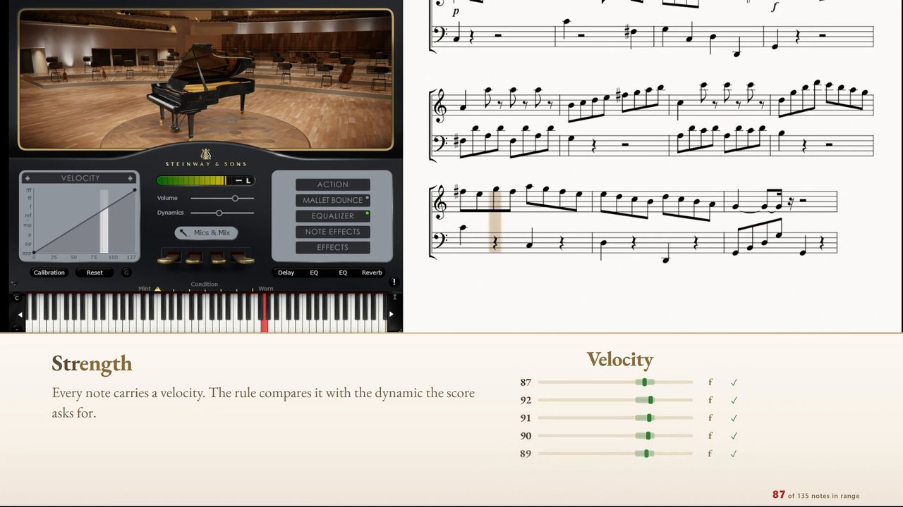
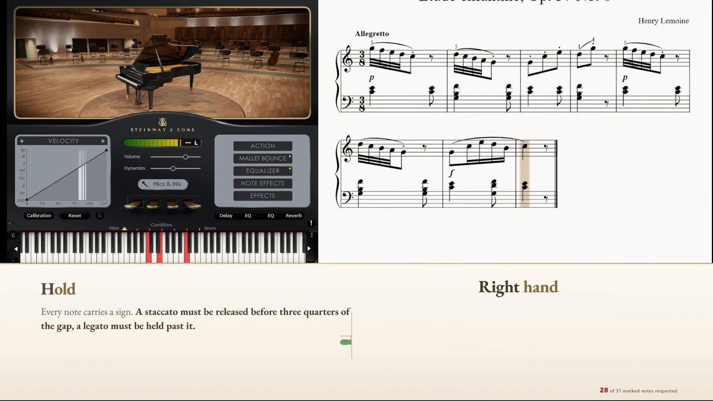
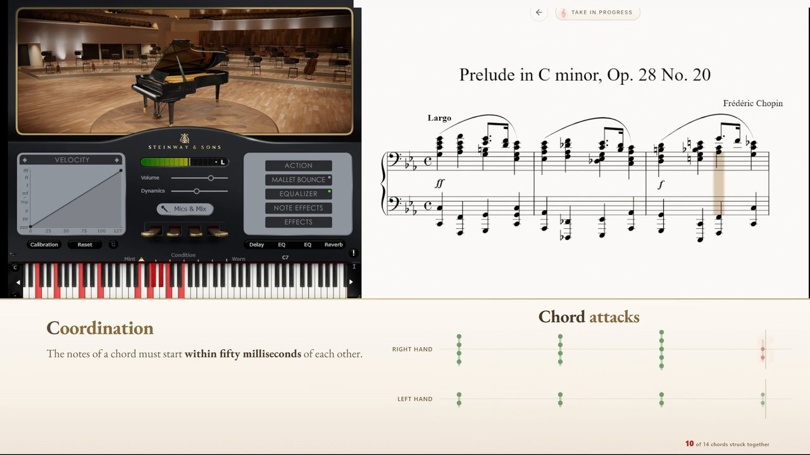
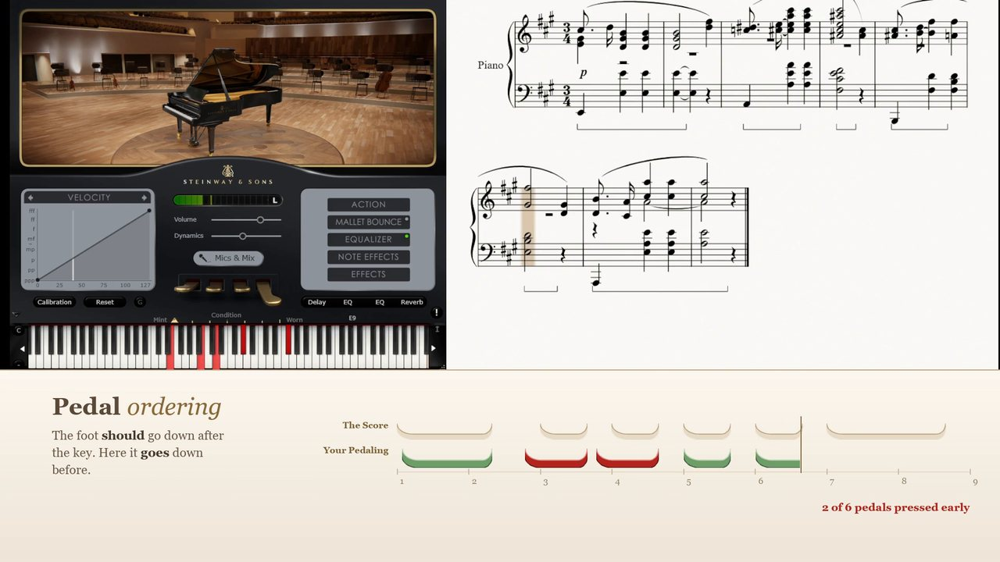

# Cadenza

Cadenza compares what a student plays at a MIDI piano with what the score asks, and
returns one verdict per criterion instead of a single grade. The criteria are written in
RML (Rewrite Modulo Logic) and compiled to Prolog monitors; the web application draws the
verdicts on the score while the student plays and stops the piece on the note that
departs from the instructions.

**Live application**: <https://cadenza-etji.onrender.com>

## The seven criteria

Each criterion is one specification in [`rml/metrics/`](rml/metrics/), compiled to a
Prolog monitor that reads the annotated trace of a take.

| Specification | Criterion | What it reads |
| --- | --- | --- |
| [`pitch-agreement.rml`](rml/metrics/pitch-agreement.rml) | key identifiers | the pressed key against the written note, within an octave-equivalent distance |
| [`pitch-range.rml`](rml/metrics/pitch-range.rml) | range | that every attack uses a key the instrument has (21–108) |
| [`dynamics-adherence.rml`](rml/metrics/dynamics-adherence.rml) | touch | the attack velocity against the written level, in a band of eight units |
| [`articulation.rml`](rml/metrics/articulation.rml) | holds | the hold against the gap to the next attack, split at a ratio of 0.75 |
| [`chord-jitter.rml`](rml/metrics/chord-jitter.rml) | grouping | the spread among the members of one chord, against the window the rule sets |
| [`pedal-toggle.rml`](rml/metrics/pedal-toggle.rml) | pedal pairing | the press and release against the marked span, within a quarter of a beat |
| [`syncopated-pedal.rml`](rml/metrics/syncopated-pedal.rml) | pedal ordering | that the press follows the keys it applies to, with no numeric tolerance |

## Demonstrations

Five recordings cover the seven criteria, each judging two takes of a real piece: one
take that follows the score and one that breaks a single policy. The score
beside each account is the frame the application drew while the take was played. Every
take runs through the same chain the deployed application uses, and all seven monitors
judge both, so the target criterion rejects while the other six accept.

[](evaluation/videos/pitch-agreement.mp4)

**Pitch agreement** — Satie, *Gymnopédie* no. 1. Six keys shifted up two semitones; six
attacks rejected, thirty-five accepted. [video](evaluation/videos/pitch-agreement.mp4)

[](evaluation/videos/dynamics.mp4)

**Dynamics** — Clementi, Sonatina op. 36 no. 1. One touch at 83–93 whatever the score
asks; twenty-six notes rejected. [video](evaluation/videos/dynamics.mp4)

[](evaluation/videos/articulation.mp4)

**Articulation** — Lemoine, *Étude enfantine* op. 37 no. 6. Every release cut to a third
of the gap to the next attack; three notes rejected, all of them legato or tenuto.
[video](evaluation/videos/articulation.mp4)

[](evaluation/videos/chord-coordination.mp4)

**Chord coordination** — Chopin, Prelude op. 28 no. 20. Three chords rolled by 170, 90 and
90 ms; four attacks rejected. [video](evaluation/videos/chord-coordination.mp4)

[](evaluation/videos/pedal.mp4)

**Pedal pairing and ordering** — Chopin, Prelude op. 28 no. 7, the page where six spans
apply. Two releases 580 ms late are rejected by pairing alone; two presses 140 ms early
are rejected by ordering alone. [video](evaluation/videos/pedal.mp4)

## Repository layout

| Path | What it contains |
| --- | --- |
| [`web-app/`](web-app/) | the browser application: capture, score rendering, verdict display |
| [`server/`](server/) | the analysis service that joins a take with the score and writes the annotated trace |
| [`rml/`](rml/) | the seven specifications and the Prolog monitors compiled from them |
| [`scores/`](scores/) | the scores the application parses, as MusicXML |
| [`evaluation/`](evaluation/) | the measurements, their frozen expectations and the videos above |
| `render.yaml`, `vendor/` | deployment to Render and the Prolog runtime it carries |

## Running it locally

The service needs Python 3.11, Java and SWI-Prolog; the browser application needs Node 20.

```bash
cd server && pip install -r requirements.txt
cd web-app && npm install && npm run dev
```

`evaluation/scripts/run.sh` reproduces the measurements, with the exact environment,
recorded versions and provenance in [`evaluation/README.md`](evaluation/README.md).

## Status and limits

The system assesses what a MIDI keyboard reports, so an acoustic piano played without
sampling is out of reach, and a marking the score does not encode cannot constrain a
verdict. The numeric policies are calibrated on a handful of performances, not on a corpus
of student attempts, and should be re-tuned as traces accumulate. Cadenza reports objective
parameters of an attempt; it is not a substitute for a teacher.
